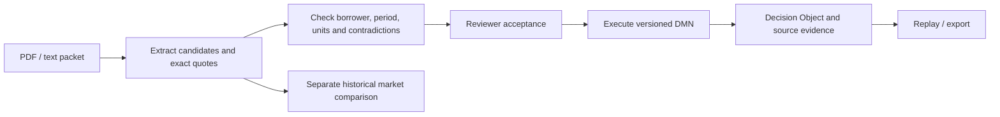

# Credit Decision Console

A local, working hackathon prototype for source-linked financial-policy checks on an Italian small-business secured term loan. The reviewer can inspect a document's exact evidence, execute a DMN decision, compare historical company performance with ISTAT aggregates, and replay a saved record.

## Open on Camila's computer

Double-click **Start-Console.cmd**. The interface opens at **http://127.0.0.1:8765**. Dependencies are installed in this checkout. The launcher uses the bundled Node runtime when available; no API key is needed for the offline demonstration.

## What to demonstrate

1. **Application review:** select Complete packet and Evaluate packet. Inspect DSCR **1.40**, debt/EBITDA **3.00**, and LTV **66.67%**. These pass the explicitly illustrative baseline policy.
2. Click an evidence link to see its quote and source page. Download the actual executed `.dmn` and Decision Object.
3. Select Missing repayments or Conflicting statements. Both produce **ABSTAIN**, with the missing or contradictory evidence named.
4. Upload `fixtures/complete-packet.pdf`. It initially abstains until you check and accept the extracted evidence; acceptance creates a new linked record.
5. **Market comparison:** compare the sample's 2024 history with Italian enterprises employing 10–19 persons. Change the year to see incompatible comparisons suppressed.
6. **Rules & rulebooks:** open the EBA and Bank of Italy sources, inspect the source-to-rule mapping, and distinguish regulatory requirements from demo limits.
7. **Records & replay:** replay frozen inputs; choose demo v2 to create a new assessment with a tighter coverage threshold.
8. **Verification:** run 20 predefined checks. **Activity console:** type `help`, `run missing`, `replay`, `verify` or `benchmark`.

## Pipeline



The open-source engine is **@smarthorizon-labs/dmn 0.1.0**, executing **DMN 1.5** with decimal arithmetic. Financial formulas and thresholds execute in the exported XML model; this is not a rendered table backed by separate financial `if` statements. Evidence validation happens before the DMN evidence gate. This early engine release is pinned for the prototype, not certified for bank production. The earlier plan's KIE/DMN 1.6 candidate was replaced after the local availability check.

## Regulatory sources and demo policy

- **EBA/GL/2020/06**, especially §5.1, §5.2.5, §4.3, §5.3 and the enterprise annexes: `sources/eba.pdf`.
- **Bank of Italy Circular 285**, update 52, Part I / Title IV / Chapter 3 / Annex A.2, PDF pp. 412–413: `sources/bdi.pdf`.

These sources establish assessment and governance requirements. They do **not** supply universal loan-approval cutoffs. Baseline DSCR ≥1.25, debt/EBITDA ≤3.50 and LTV ≤80% are **demo assumptions**. The regulatory-only policy has no cutoffs and abstains. DSCR includes existing AND proposed principal and interest. Scope is deliberately limited to one EUR small-company secured term loan, 2026 financial figures and a 2027 repayment forecast.

The checks do not complete KYC/AML, credit-register checks, fraud review, qualitative assessment, forecast validation, collateral/legal work, pricing, delegated authority or a bank's full credit policy. `PASS_POLICY_CHECKS` is not loan approval; failure is not a formal refusal.

## Italian market dataset

**ISTAT, Conti economici delle imprese e dei gruppi di impresa — Anno 2024**, published **15 October 2026**, table on PDF page 2. The underlying table covers **4,532,053 enterprises** in industry and market services. The source PDF is included as `sources/istat-2024.pdf`; the interface exports a source-attributed JSON dataset.

[Official ISTAT publication](https://www.istat.it/wp-content/uploads/2026/10/Conti-economici-imprese-e-gruppi-2024.pdf).

Charts show turnover per person (calculated from published totals), value added per person, and labour cost per employee. Published monetary ratios are rounded. These are national aggregate ratios by size, across included industries and legal forms, not medians or credit-risk percentiles. Persons employed includes working owners; employees is a separate denominator. No sector, regional or incorporation-status match is claimed. This dataset supplies no national DSCR, debt/EBITDA or LTV benchmark. Market comparisons never change the DMN outcome.

## Install on another machine

Requirements: Node ≥22.12, pnpm, and Python with pypdf. From this folder:

```text
pnpm install --frozen-lockfile --ignore-scripts
python -m pip install -r requirements.txt
node server.mjs
```

Open http://127.0.0.1:8765. If Python is not on PATH, set `CREDIT_PYTHON` to its executable. `PORT` changes the local port. The server binds to loopback only. `CREDIT_DATA_DIR` can place records outside the default `data/` directory.

## Extraction and supported inputs

Offline mode recognizes the explicit financial labels, periods and units used in the supplied fixtures. Accepts text PDFs, TXT and MD: 1–10 files, PDF ≤4 MB / 30 pages, extracted text ≤160,000 characters per file. It does not implement OCR or a general financial-statement parser. Unsupported or unreadable evidence abstains. PDF source text must identify the borrower and scope; see the fixtures for the supported metadata contract.

Optional **Configure AI** connects the Vercel AI Gateway OpenAI-compatible endpoint. Enter the organizer's key and a supported provider/model ID in the local UI. Alternatively use a private `.env` containing `AI_GATEWAY_API_KEY` and `AI_GATEWAY_MODEL`. Credentials remain server-side and are not returned in records. Selecting AI extraction sends document text to that gateway; the app checks quoted evidence and requires reviewer acceptance. A live provider call has **not** been validated in this build because no key was supplied. AI/network failure is an explicit operational error, not a fabricated result. No fallback is silently substituted.

## Verification and storage

```text
node --test tests/*.test.mjs
node cli.mjs benchmark
node cli.mjs demo complete
node cli.mjs dmn demo-v1
```

Observed: **20/20** predefined benchmark cases passed, including **10/10** abstention cases with **0** unsafe passes. All **12** automated integration tests passed, including PDF extraction/review, same-file borrower conflicts, malformed files, locale formats and market comparability. The 20-case benchmark is invoked within one integration test; do not add the two counts as independent cases. Browser interaction checks covered the complete workflow and mobile width. Results apply to the defined synthetic fixtures and offline extraction, not arbitrary real packets or live AI.

`data/records` stores new JSON records using exclusive creation. Records include evidence, source hashes, inputs, rule/policy versions, the executed model, engine trace and payload hashes. Replay uses frozen facts and XML without an LLM call. Hashes detect uncoordinated edits, but records and hashes live on the same writable machine: **this is not immutable storage or a trusted audit ledger**. Production would need authenticated reviewers, access control, signed/external audit anchoring, retention controls and a lender-approved policy. Uploaded documents and run history are private local data; `data/` is ignored by Git.

## Project layout

`public/` interface · `lib/` policy, extraction, pipeline and market data · `fixtures/` synthetic PDFs · `sources/` official rulebooks/dataset · `tests/` checks · `delivery/` plan, reports, datasets and screenshots · `cli.mjs` command-line interface.

Workflow and visual inspiration: [Abubakar17/hackathon, bakar branch](https://github.com/Abubakar17/hackathon/tree/bakar). This console is a separate implementation. The DMN runtime is Apache-2.0; third-party sources and data retain their original rights. No repository push, event submission or real credit decision is implied by this local build.
