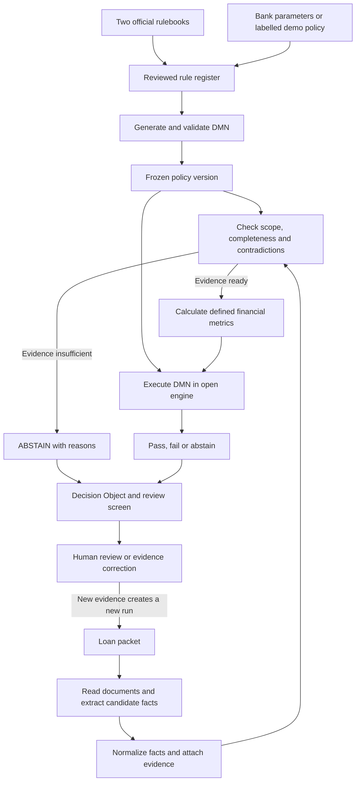

**Commercial loan evidence-to-decision pipeline — planning specification**

Prepared 14 November 2026. This is the original planning baseline; implementation now exists. Current implementation: a Node console with Python PDF extraction, DMN 1.5 executed by @smarthorizon-labs/dmn 0.1.0, versioned demonstration policies, evidence review, replay and official ISTAT 2024 market comparisons. The earlier KIE/DMN 1.6 candidate below was superseded after checking local engine availability. See START_HERE.md and the application's README for the implemented scope and observed verification. Remaining proposals below are design targets, not claims that all proposed controls were delivered.

**1. The decision we are building**

Proposed scope: assist an Italian bank reviewing a EUR term-loan application from a small incorporated operating business. The prototype checks whether the evidence supports a specified financial-policy assessment, and records the result for an underwriter. Consumer loans, sole traders, medium/large companies, complex groups, project finance and revolving facilities require separate scope and policies.

User: commercial credit analyst. Policy owner and prospective buyer: the bank's credit-risk function. Time wasted, willingness to pay and availability of internal policy/data remain unverified customer hypotheses.

The three business outcomes are PASS_POLICY_CHECKS, FAIL_POLICY_CHECKS and ABSTAIN. A pass means the implemented checks passed; it is not loan approval or certification of regulatory compliance. Qualitative assessment, identity/AML checks, fraud controls, legal enforceability, delegated authority and final credit approval remain with the bank.

Riskiest assumption: a lender will provide explicit policy definitions and permissioned example packets, and find the evidence-linked result useful in its workflow. Proposed commercial test: speak with three relevant practitioners; require two to describe a recent concrete evidence-reconciliation problem and one policy owner to agree to a scoped pilot with policy and sample access. Otherwise narrow the proposition; do not claim buyer validation.

Technical stop criterion: any incomplete or contradictory test case that produces PASS_POLICY_CHECKS blocks the demonstration's success claim. Also require positive controls to pass, so a system that always abstains cannot pass the benchmark.

**2. The two regulatory sources and their limits**

The source documents are the unchanged official PDFs already downloaded:

- [EBA/GL/2020/06](../sources/eba.pdf): use the enterprise provisions, replacing the consumer provisions used earlier.
- [Bank of Italy Circular 285, update 52](../sources/bdi.pdf): Part I, Title IV, Chapter 3, Annex A, paragraph 2; PDF pages 412–413.

| Source location | Regulatory topic | Proposed implementation; not a verbatim legal rule |
|---|---|---|
| EBA §5.1, paragraphs 84, 86, 89, 94; pp. 33–34 | Evidence quality, enterprise information and documentation | Store source references; flag missing or conflicting evidence |
| EBA §5.2.5, paragraphs 118–123; p. 38 | Repayment capacity, cash flow and loan structure | Assess cash-flow and debt-service inputs |
| EBA paragraph 120; p. 38 | Collateral is secondary to repayment capacity | No collateral-based override of failed repayment checks |
| EBA paragraphs 128–131; pp. 39–40 | Financial position, projections and adverse conditions | Version metric definitions; flag forecast and stress-review needs |
| EBA paragraphs 132–136; p. 40 | Business model and strategy | Preserve qualitative review tasks |
| EBA Annex 2.B; p. 72 | Enterprise evidence | Define the packet checklist |
| EBA §4.3 and §5.3; pp. 21–23, 50 | Policy governance and documented decisions | Separate policy approval from case processing |
| Circular 285, Annex A.2; pp. 412–413 | Internal rules, underwriting and decision authority | Record policy owner, version, reviewer and authority |

Annexes 1 and 3 of the EBA document identify criteria and metrics; they do not supply universal numerical approval limits. The regulatory sources justify the assessment framework. Numeric thresholds and detailed metric definitions need an approved bank policy. For a demonstration, a clearly named DEMO_POLICY can supply illustrative values, but none have been chosen in this plan. They must never be represented as EBA or Italian legal thresholds.

A rule register must record: rule ID; source and exact location; original requirement; our interpretation; whether it is regulatory, bank policy or demo assumption; applicable product/entity; effective dates; required evidence; expression; parameter values; reviewer; version.

Do not use the Consumer Credit Directive as the corporate-loan legal basis. Do not claim the two documents establish a blanket prohibition on LLMs: EBA paragraph 38(g) expressly addresses conditions for automated decision-making. An auditable policy trace is not by itself a legal opinion.

**3. The architecture: two separate paths**

The policy path runs when policy changes. The application path runs for each case. Borrower documents cannot create or amend policy. An LLM can propose extractions or draft rule mappings, but neither enters the active model without validation and review.

The .dmn file is the executable model, not a newly invented ruling for each applicant. Each case export contains the exact model used, the accepted input snapshot and its Decision Object. A policy revision produces a new model version; old cases retain the old one.

**4. Stage-by-stage contract**

| Stage | Input and work | Output | Completion check |
|---|---|---|---|
| 0. Freeze scope and policy | Select one borrower/product scope; review sources; define parameters | Rule register and policy manifest | Every rule has an authority and reviewer; unknown thresholds remain unknown |
| 1. Compile policy | Convert reviewed structured rules to DMN XML; validate schema and engine semantics | Versioned .dmn, source map and model hash | Engine loads it; fixture outcomes and rule IDs are correct |
| 2. Register packet | Check file types, pages and borrower; hash original files | Packet manifest and document IDs | Original file identity and case identity are recoverable |
| 3. Extract candidates | Read text PDFs; use OCR/vision only for supported pages; constrain extraction to a schema | Candidate facts, source spans, uncertainty and missing fields | No unreferenced financial value is accepted |
| 4. Normalize and reconcile | Check units, currencies, periods, signs, entity and actual/forecast status | Accepted facts or unresolved issues | Conflicts are preserved, not silently overwritten |
| 5. Evidence gate | Apply the scoped required-evidence checklist and validity rules | READY or ABSTAIN with reason codes | Missing values never become zero; ambiguity cannot pass |
| 6. Compute metrics | Apply fixed formulas using decimal arithmetic and accepted facts | Metrics with calculation lineage | No guessed inputs, invalid denominators or mixed periods |
| 7. Execute decision | Send validated facts/metrics to the pinned DMN engine | Outcome, matched decisions/rows and reason codes | The executed model is the downloadable model |
| 8. Seal record | Store inputs, policy, outputs, versions and evidence links | Decision Object and export bundle | Independent integrity check detects an edited payload |
| 9. Review and replay | Show evidence and reasons; accept documented corrections as new events | New version or repeat evaluation | Earlier records remain accessible; replay has the same semantic result |

The same evidence gate must be exercised by the runnable decision service. A frontend warning alone does not count as deterministic abstention. Structural validation failures stop evaluation; they are recorded as operational errors, never as borrower credit failures.

**5. What the packet and facts contain**

Proposed packet checklist, subject to the actual lender policy:

- Application: entity identity, purpose, requested amount, proposed term and repayment schedule.
- Financial statements and notes: balance sheet, income statement and cash-flow information for the relevant periods.
- Debt and forecast schedules: existing facilities, new-loan debt service, projected cash available for repayment, assumptions and preparation date.
- Bank and tax records: supporting transactions, tax position and liabilities where required.
- For secured lending: valuation, ownership, prior claims and the bank's accepted eligible collateral value.
- Reviewer checklist: relevant business-model, stress, credit-history and other assessments not automated in the demo.

For the first demonstration, package this into a small number of short PDFs with a single entity, EUR and aligned periods. Text PDFs are the initial supported format; unsupported scans produce a clear abstention until OCR is tested. Bank credits are not automatically revenue, and taxable income is not automatically accounting profit.

Each financial observation carries: field name; decimal value or explicit absence; currency and unit scale; entity; period; actual/forecast designation; consolidated/standalone scope; document ID and hash; page and exact source span; extraction version; validation status. A conflict means incompatible observations for the same concept and scope, not simply two different numbers on two pages.

A confidence score is a routing signal, not proof that an extraction is correct. Citation presence and arithmetic checks also do not establish document authenticity. During the prototype, the reviewer checks the critical evidence before accepting the fact snapshot.

**6. The three proposed metric checks**

These are proposed definitions to review with the policy owner, not definitions or thresholds imposed universally by the two rulebooks.

| Metric | Proposed calculation | Required clarification before implementing |
|---|---|---|
| DSCR | Cash flow available for debt service / principal and interest due over the same period, including the proposed loan | Define cash available, existing/new debt coverage, forecast horizon, stress scenario and minimum accepted ratio |
| Leverage | Post-loan gross interest-bearing debt / EBITDA for the defined period | Define debt inclusions, EBITDA adjustments, period and maximum ratio |
| Collateral LTV | Secured exposure / accepted eligible collateral value | Define valuation basis, haircuts, prior-ranking claims, eligible assets and maximum LTV |

DSCR cash available must not be silently substituted with EBITDA or cash receipts. Interest must not be deducted twice. Zero or negative EBITDA makes this leverage calculation unsuitable for a simple positive-ratio rule: route it to review. Missing or non-positive collateral value cannot yield a passing ratio. An unsecured case makes collateral NOT_APPLICABLE only if the selected policy explicitly permits it.

Policy parameters: minimum_DSCR, maximum_leverage, maximum_LTV, evidence_freshness, accepted_periods, required_documents and reconciliation_tolerances. Their values are currently UNCONFIGURED. Until configured and reviewed, the engine must abstain from those policy comparisons.

**7. Decision semantics and abstention**

| Condition | Outcome |
|---|---|
| Policy missing, not effective or ambiguous | ABSTAIN — POLICY_GAP |
| Required evidence missing or not accepted | ABSTAIN — MISSING_EVIDENCE |
| Same-scope evidence remains contradictory | ABSTAIN — CONFLICTING_EVIDENCE |
| Unsupported borrower/product, invalid metric or uncovered condition | ABSTAIN — OUT_OF_SCOPE / INVALID_METRIC / NO_RULE |
| Valid evidence and all implemented policy checks pass | PASS_POLICY_CHECKS — underwriter review remains |
| Valid evidence and at least one implemented threshold fails | FAIL_POLICY_CHECKS — identify the exact failed rules |
| Parsing, compilation or engine failure | Operational ERROR with no credit recommendation |

Collect all relevant reason codes. Use mutually exclusive final-outcome rules; explicitly handle no-match and multiple-match errors. Do not coerce a null or unknown comparison into a failed credit threshold or a pass. Corrections produce a new evidence snapshot. A human override, if later supported, is a separate signed/attributed event and never edits the engine's original result.

**8. Decision Object and explanation**

The proposed record contains: case and run IDs; creation time; scope; original-document hashes; accepted-fact snapshot and evidence links; unresolved issues; formulas and intermediate results; policy/model ID, version, hash and effective date; DMN engine version; matched row IDs; outcome and reason codes; extraction model/prompt version; reviewer actions; prior-event reference; payload hash.

The user-facing explanation is assembled from the executed rules and recorded facts. Example of an abstention template: “We cannot assess debt coverage because the existing-loan principal repayment schedule for [period] is missing. Required by [policy rule]; requested evidence: [schedule].” The absent schedule cannot have a fabricated page citation; cite the policy requiring it and the documents searched. For contradictory values, show both source locations.

The demo can demonstrate append-only application behavior and tamper evidence. A hash alone does not make storage immutable: an administrator could rewrite data and hashes. A trusted external manifest/anchor is needed to detect coordinated rewriting; production retention controls, signing and independent audit storage are later work. Avoid claiming cryptographic immutability in the pitch.

Replay uses the accepted facts, model, parameters and pinned engine version without calling the LLM again. Compare semantic results, metrics, reasons and matched rules; run timestamps and audit-chain metadata can differ. A fresh extraction run is a separate experiment, not guaranteed identical replay.

**9. Proposed stack and interface**

Use one small Python service for document processing, validation and the interface, plus a local Apache KIE/Drools decision service. Start with DMN 1.6 and KIE 10.2.0 as a candidate tested pair; confirm installation and one executable table before committing to the rest. OMG publishes the DMN 1.6 specification, and Apache's 10.2.0 release announcement reports editor and engine support. These are source-verified capabilities, not proof this local environment is configured.

Use a simple three-panel screen: source documents; extracted facts and issues; result with matched rule and version. Include “Download decision bundle” and “Replay recorded inputs.” The editor can be opened separately to show that the exact exported .dmn loads and runs. A hand-coded rules screen with a decorative XML export does not satisfy the abstract.

Use one bounded server-side extraction call per supported packet or document; cache results for the demo. Keep model credentials server-side. Record actual tokens, cost and latency instead of guessing. Use local files/SQLite for the prototype; no login, payments, multi-tenancy, vector database, autonomous policy updates or bank integration in the hackathon build.

**10. Sequential build plan**

| Order | Work in this chat | Hard exit condition |
|---|---|---|
| 1 | Review this architecture; freeze decision, evidence schema and policy-parameter status | One agreed scope and one explicit source/assumption register |
| 2 | Run the smallest real DMN model in the chosen engine | One complete input passes; one missing input abstains; rule IDs are captured |
| 3 | Create labelled packet fixtures and independently expected results | A positive packet and negative variants exist before engine tests |
| 4 | Connect one real extraction path to evidence references and normalization | Reviewer can trace every decision-critical value |
| 5 | Wire the evidence gate, three metric definitions and frozen policy | Invalid evidence cannot reach a passing outcome |
| 6 | Add Decision Object, replay and minimal interface | Downloaded bundle reproduces the displayed decision |
| 7 | Execute the check set, repair failures and record results | Exact passed/total figures, failures and scope limitations are visible |
| 8 | Freeze; record fallback; prepare pitch and delivery | Same flow runs on the demo machine and has an honest recorded backup |

First technical timebox: 10 minutes for engine availability and one table. If that fails, try a smaller real supported DMN setup; do not silently replace the core with Python if-statements. Keep DMN execution, cited evidence and abstention. Reduce packet length, supported formats and UI scope first.

The full architecture exceeds what should be promised before the early engine/data check. A partial build must be described as partial. Application coding is the next phase; this deliverable specifies the pipeline, as requested.

**11. Evidence and acceptance plan**

Write a 20-case check set before tuning extraction. Planned cases: (1) complete passing control; (2) DSCR failure; (3) leverage failure; (4) collateral failure; (5) missing cash-flow numerator; (6) missing existing debt service; (7) conflicting same-period financial figure; (8) wrong entity; (9) unresolved currency/unit ambiguity; (10) mismatched periods; (11) zero/negative denominator; (12) missing required collateral evidence; (13) unconfigured threshold; (14) out-of-scope application; (15) boundary exactly equal to a threshold; (16) engine failure; (17) document text instructing the model to ignore policy; (18) tampered saved record; (19) replay with the old model; (20) same facts under a reviewed new policy version.

The expected outcome and reasons for each case must be independently specified. Establish threshold-specific cases only after the demonstration policy is explicitly defined. Mark all fixtures synthetic, public-source, or permissioned real data. No real loan packet has been supplied in this session; public financial statements alone are not a real complete loan application.

Measure separately:

- Engine abstention: correctly abstained incomplete/contradictory cases / all such cases.
- Unsafe passes: incomplete/contradictory cases producing PASS_POLICY_CHECKS; acceptance target zero.
- Positive controls: valid cases correctly evaluated, so blanket abstention fails.
- Extraction: exact values, periods, units and correct evidence spans against human-labelled ground truth.
- Reproducibility: identical semantic result from frozen facts and policy.
- Integrity: modified record rejected against a separately retained expected hash/manifest.
- Performance: extraction time, review interaction time, engine time and end-to-end time separately.

“100%” may describe only a reported finite check set, for example n/n cases, with the actual denominator. It is neither proof for every future PDF nor an extraction-accuracy guarantee. A formal proof would need a separately specified formal model and verified assumptions; it is outside this prototype.

**12. Hackathon fit, demo and delivery**

The attached market research identifies the opportunity between unstructured requests and governed decisions, and proposes replay, visible rule versions and routing uncovered cases to people. This plan makes those mechanisms the core. It does not claim novelty over vendors based on that brief alone.

The event guide for the decision-models track assigns Gate 2 weights: real working demo 18%, financial sustainability 17%, technical feasibility 16%, build quality 15%, adoption/deployment 13%, selling story 11%, fidelity to the initial proposal 10%. These are guide facts; this session has no connected Control8 tool to verify team status or submissions.

On 14 November, the guide places financial validation at 16:30 and delivery closure at 16:45 Rome/Berlin time. The idea video/abstract deadline was 12:30; do not assume it can be replaced now. Continuation into Phase II and the actual submitted abstract are not verified here. The final slot is five minutes including questions; plan a three-minute demonstration.

Proposed three-minute flow: 0:00–0:20 name the credit analyst's task without inventing time-savings data; 0:20–1:10 process the complete fixture and open the supporting source/DMN row; 1:10–1:45 remove debt-service evidence and show ABSTAIN with the requested evidence; 1:45–2:10 replay the stored case and show the pinned version; 2:10–2:35 show exact benchmark results and real/synthetic/cached labels; 2:35–3:00 explain the pilot and measured business case. Keep a recorded fallback and a local saved extraction clearly labelled as replay.

Delivery checklist: public repository without secrets or confidential borrower files; runnable model and instructions; benchmark report; source/assumption register; pitch deck and artifact explicitly marked with genre pitch; current start/check pages; economic model; demo recording. The event platform's static pitch is not the live application. These are planned deliverables; none has been published in this session.

Proposed commercial offer: a scoped paid pilot for one loan product and one lender policy. Measure active analyst minutes on the same packets before and with assistance, including corrections and exceptions; do not equate turnaround time with labour. Monthly net operational value = eligible packet volume × observed minutes saved / 60 × loaded hourly labour cost − operating and review costs. Price, volume, labour cost and acquisition cost remain unverified assumptions until measured or obtained from a buyer. No euro savings or market-size figure is asserted.

**13. Main failure points and mitigations**

| Failure point | Impact | Mitigation and owner | Deadline |
|---|---|---|---|
| No explicit lender policy | Cannot support real credit recommendations | Policy workstream in this chat: labelled demo parameters or abstain | Before threshold tests |
| No authentic permissioned packets | Cannot claim a real-world packet demonstration | Data workstream: labelled realistic fixtures; request permissioned samples for pilot | Before data claims |
| DMN engine/version mismatch | Core is not executable | Implementation workstream: smallest real model first | First technical timebox |
| Extraction loses evidence or confuses periods | Wrong inputs can produce confident decisions | Validation workstream: ground truth and evidence gate | Before any pass demonstration |
| Network/model/credits unavailable | Live extraction fails | Local recorded extraction plus honest replay; keep actual DMN execution local | Before freeze |
| One machine or undocumented setup | Demonstration cannot restart | Short run instructions, saved artifacts, recorded backup | Before delivery |
| Append-only store is overstated | Unsupported audit claim | Call it tamper-evident; retain independent manifest; document limits | Before pitch |

All workstreams are responsibilities handled sequentially in this session, not separate people or agents. The defensible advantage is a lender-approved policy mapping and tested evidence/replay workflow; a prompt, generic UI or open-source engine is not a moat. A policy-specific corpus and correction benchmark are future assets, not assets already held.

**Official references**

- [EBA final report and guidelines](https://www.eba.europa.eu/sites/default/files/document_library/Publications/Guidelines/2020/Guidelines%20on%20loan%20origination%20and%20monitoring/884283/EBA%20GL%202020%2006%20Final%20Report%20on%20GL%20on%20loan%20origination%20and%20monitoring.pdf)
- [Bank of Italy Circular 285 publication index](https://www.bancaditalia.it/compiti/vigilanza/normativa/archivio-norme/circolari/c285/index.html)
- [Bank of Italy implementation Note 13](https://www.bancaditalia.it/compiti/vigilanza/normativa/orientamenti-vigilanza/elenco-esa/note/Nota-n-13-del-20-luglio-2021.pdf)
- [OMG DMN 1.6 specification](https://www.omg.org/spec/DMN/1.6/)
- [Apache KIE DMN engine](https://kie.apache.org/drools/dmn/)
- [Apache KIE 10.2.0 release](https://kie.apache.org/blog/kie_10_2_0_release/)
- Hackathon basis: the user's attached “AI brain for industry · market research for the track Decision models…” and the organiser event guide available in this session. Market-research hypotheses retain their unverified status.
